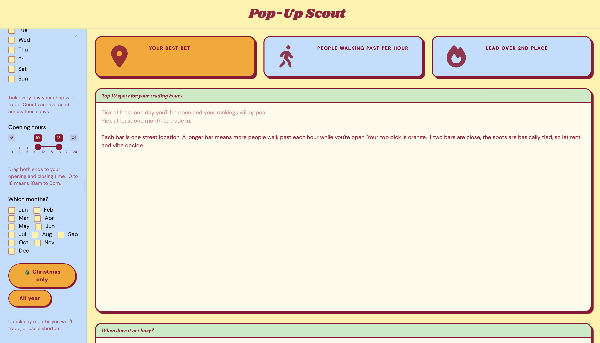

# Finding a spot for your pop-up

So you’ve got a rack of clothes, a few weeks and a plan to open a pop-up
in Melbourne’s CBD. The big question is where. This guide shows you how
to use melbfoot and its app, Pop-Up Scout, to answer it with real foot
traffic data.

## Install and load

melbfoot lives on GitHub. Install it once with:

``` r

# install.packages("remotes")
remotes::install_github("ETC5523-2026/etc5523-assignment-4-anan0016-collab")
```

Then load it whenever you want to use it:

``` r

library(melbfoot)
```

## Launch the app

``` r

run_app()
```

Pop-Up Scout opens in a new window.


## Using the controls

Everything lives in the blue sidebar on the left, and the page updates
as soon as you change anything.

- **When are you open?** Tick every day you’ll trade. Counts are
  averaged across those days, so ticking Saturday and Sunday gives you a
  typical weekend.
- **Opening hours.** Drag both ends of the slider to your opening and
  closing time. `10` to `18` means 10am to 6pm. The hour from 6pm to 7pm
  isn’t counted, because you’re closed by then.
- **Which months?** Untick any months you won’t trade. The **🎄
  Christmas only** button jumps straight to November and December, and
  **All year** ticks everything again.

## Reading the results

### The three boxes

- **Your best bet** is the location with the most people walking past
  during your trading hours.
- **People walking past per hour** is how many people pass that spot in
  an average hour while you’re open.
- **Lead over 2nd place** tells you how clear the win is. Something like
  30% means a genuine standout. Something like 3% means it’s basically a
  tie, so let rent, foot traffic on the day and vibe decide.

### Top 10 spots

Each bar is one street location, and a longer bar means more people walk
past. Your top pick is **orange**. A **hollow** bar means that sensor
missed a lot of days during the year, so its average is shakier. The app
names these locations under the chart.

### When does it get busy?

This chart shows your top 3 spots hour by hour. The **blue band** is
your opening hours. You want each line to peak *inside* the band. If a
line peaks outside it, the crowds turn up when you’re closed.

## An example: a Christmas pop-up

Say you’re planning a weekend pop-up for November and December. Here’s
what the app does behind the scenes, using the same function it calls:

``` r

xmas <- rank_locations(
  foot_traffic, sensors,
  days = c("Sat", "Sun"),
  hours = c(10, 18),
  months = c("Nov", "Dec")
)

head(xmas[, c("rank", "location_name", "avg_per_hour", "limited_data")], 5)
#> # A tibble: 5 × 4
#>    rank location_name                  avg_per_hour limited_data
#>   <int> <chr>                                 <dbl> <lgl>       
#> 1     1 Town Hall (West)                       3392 FALSE       
#> 2     2 Flinders La-Swanston St (West)         2946 FALSE       
#> 3     3 Southbank Promenade                    2450 FALSE       
#> 4     4 Bourke Street Mall (North)             2397 TRUE        
#> 5     5 Bourke Street Mall (South)             2296 FALSE
```

The ranking alone hides something interesting. Here’s the hour-by-hour
pattern for the top 3:

``` r

library(ggplot2)

hourly_profile(
  foot_traffic, sensors,
  location_ids = xmas$location_id[1:3],
  days = c("Sat", "Sun"),
  months = c("Nov", "Dec")
) |>
  ggplot(aes(x = hour, y = avg_per_hour, linetype = location_name)) +
  annotate("rect", xmin = 10, xmax = 18, ymin = -Inf, ymax = Inf,
           fill = "#BEDEFF", alpha = 0.6) +
  geom_line(colour = "#930031", linewidth = 1) +
  labs(x = "Hour of the day", y = "People per hour", linetype = NULL) +
  theme_minimal() +
  theme(legend.position = "bottom")
```


The Swanston Street spots peak in the early afternoon, comfortably
inside the 10am to 6pm window. **Southbank Promenade** is different: its
crowds keep building into the evening and peak around closing time. So
if you choose Southbank for a Christmas pop-up, staying open a couple of
hours later is probably worth it.

Here’s the same pattern in the app:


## When something doesn’t add up

Pop-Up Scout tells you what to fix rather than showing a broken chart.
If you untick every day, delete every month, or set opening and closing
to the same hour, you’ll see a message like this:



It also warns you when even the busiest spot is quiet (try 2am to 5am),
and when your top pick comes from a sensor with limited data.

## Things to keep in mind

- **Sensors count people walking past, not shoppers.** A busy footpath
  is a good start, but it doesn’t guarantee sales.
- **Only places with a sensor can be ranked.** A spot inside a shopping
  centre, like near the Melbourne Central clock, can’t be assessed.
- **Rent isn’t included.** The busiest spot might not be the one you can
  afford.
- **The data covers October 2025 to September 2026.** Big one-off events
  in that year can nudge the averages.

The data comes from the City of Melbourne’s [Pedestrian Counting
System](https://data.melbourne.vic.gov.au/explore/dataset/pedestrian-counting-system-monthly-counts-per-hour/),
licensed under CC BY 4.0.
