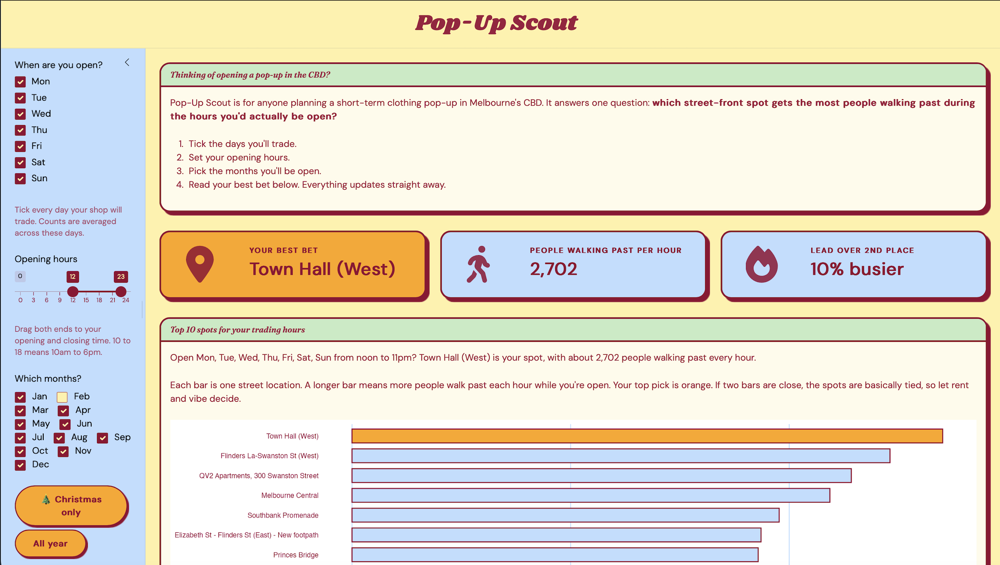

# melbfoot 

So you want to open a clothing pop-up in Melbourne’s CBD. Where should
it go?

**melbfoot** helps answer that with real foot traffic data. It packages
a year of hourly counts from the City of Melbourne’s pedestrian sensors
and comes with **Pop-Up Scout**, a Shiny app that ranks street locations
by how many people walk past *during the hours you’d actually be open*.

That last bit matters. The busiest spot at 8am on a Tuesday (commuters
rushing to work) isn’t the busiest spot at 2pm on a Saturday, and it
isn’t always the best spot for a Christmas pop-up either.


Pop-Up Scout ranking CBD locations for weekend trading

## Installation

Install melbfoot from GitHub:

``` r

# install.packages("remotes")
remotes::install_github("ETC5523-2026/etc5523-assignment-4-anan0016-collab")
```

## Launch the app

``` r

library(melbfoot)
run_app()
```

Tick the days you’ll trade, set your opening hours, pick your months,
and Pop-Up Scout shows your best bet, a top 10, and an hour-by-hour
chart so you can check the crowds peak while you’re open.

## Use the functions directly

The app is built on two functions you can use yourself. Here are the
five busiest spots for weekend trading from 10am to 6pm:

``` r

library(melbfoot)

rank_locations(foot_traffic, sensors, days = c("Sat", "Sun"), hours = c(10, 18)) |>
  head(5)
#> # A tibble: 5 × 9
#>    rank location_id location_name      avg_per_hour hours_observed days_observed
#>   <int>       <dbl> <chr>                     <dbl>          <int>         <int>
#> 1     1           4 Town Hall (West)           3291            816           363
#> 2     2          41 Flinders La-Swans…         2966            832           363
#> 3     3          66 QV2 Apartments, 3…         2459            816           363
#> 4     4          35 Southbank Promena…         2418            832           365
#> 5     5           5 Princes Bridge             2349            832           365
#> # ℹ 3 more variables: limited_data <lgl>, latitude <dbl>, longitude <dbl>
```

[`hourly_profile()`](https://etc5523-2026.github.io/etc5523-assignment-4-anan0016-collab/reference/hourly_profile.md)
gives the hour-by-hour pattern for any locations you choose. See
[`?rank_locations`](https://etc5523-2026.github.io/etc5523-assignment-4-anan0016-collab/reference/rank_locations.md)
and
[`?hourly_profile`](https://etc5523-2026.github.io/etc5523-assignment-4-anan0016-collab/reference/hourly_profile.md)
for details.

## The data

| Object | What it is |
|----|----|
| `foot_traffic` | Average pedestrians per hour at each sensor, by month, weekday and hour |
| `sensors` | Name, location and data coverage for each sensor |

The data covers **1 October 2025 to 30 September 2026** and **100
outdoor street sensors**. The 34 indoor sensors were left out because
they all sit inside council facilities like libraries, so they don’t
reflect retail foot traffic. The script that downloads and prepares the
data is in
[`data-raw/foot_traffic.R`](https://etc5523-2026.github.io/etc5523-assignment-4-anan0016-collab/data-raw/foot_traffic.R).

**Source:** City of Melbourne Open Data, [Pedestrian Counting System
(counts per
hour)](https://data.melbourne.vic.gov.au/explore/dataset/pedestrian-counting-system-monthly-counts-per-hour/)
and [Sensor
Locations](https://data.melbourne.vic.gov.au/explore/dataset/pedestrian-counting-system-sensor-locations/),
licensed under CC BY 4.0.

**Things to keep in mind:**

- Sensors count people walking past, not shoppers or buyers.
- A spot without a sensor can’t be ranked, so somewhere like inside a
  shopping centre won’t show up.
- Rent isn’t included. The busiest spot might not be the one you can
  afford.
- A few sensors missed a lot of days. The app flags these so you can
  treat their averages with caution.

## Documentation

Full documentation, including a step-by-step guide to using the app, is
at
**<https://etc5523-2026.github.io/etc5523-assignment-4-anan0016-collab/>**.

## Generative AI declaration

I used Claude (Anthropic) throughout this assignment to help choose and
scope the dataset, plan the package structure, draft and debug R code
(the data-raw script,
[`rank_locations()`](https://etc5523-2026.github.io/etc5523-assignment-4-anan0016-collab/reference/rank_locations.md),
[`hourly_profile()`](https://etc5523-2026.github.io/etc5523-assignment-4-anan0016-collab/reference/hourly_profile.md)
and the Shiny app), write CSS for the app’s styling, and draft
documentation including this README. I checked, ran and revised all
generated code and text, and I made the final decisions on the user,
question and design.
